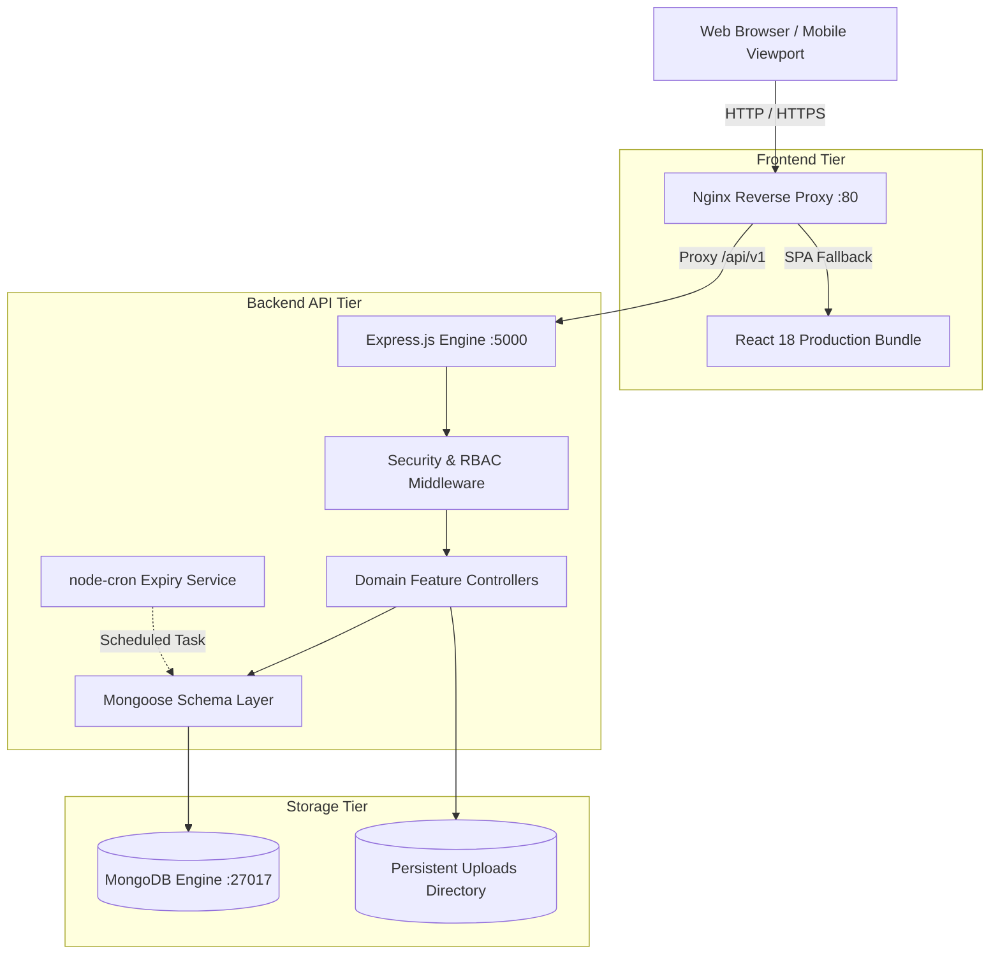
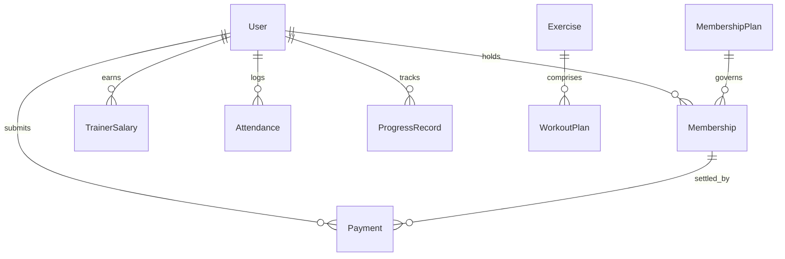
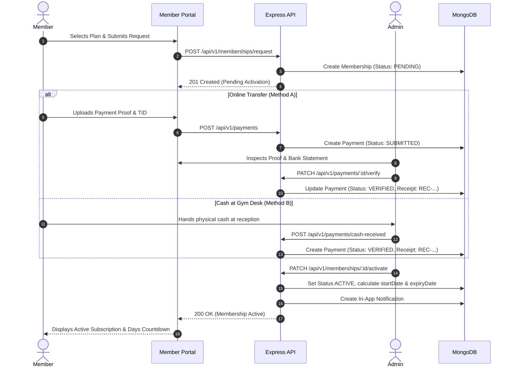
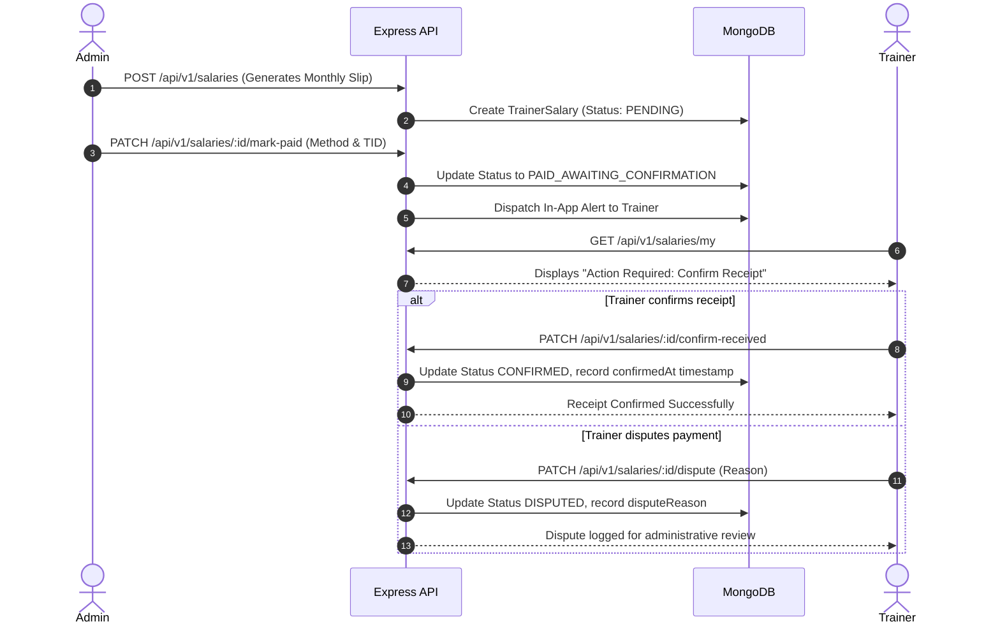
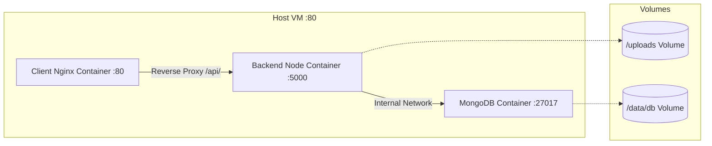

# FitTrack Pro – Smart Gym Management & Membership Subscription Platform
### Academic Problem-Based Learning (PBL) Final Project Report & Portfolio Thesis

---

## 1. Project Title
**FitTrack Pro: A Production-Grade Smart Gym Management, Athlete Progression, and Membership Subscription Platform**

---

## 2. Abstract
Traditional single-location fitness centers and gyms typically rely on fragmented paper registers, informal WhatsApp communication, and unverified manual payment spreadsheets. These manual modalities result in revenue leakages, uncollected membership dues, untracked client progression, lost payment receipts, and disputed trainer compensations.

**FitTrack Pro** addresses these critical operational vulnerabilities by introducing a centralized, responsive full-stack platform engineered with the MERN stack (MongoDB, Express.js, React.js, Node.js), Vite, and Tailwind CSS. The system provides role-based access control (RBAC) across three primary actors: Gym Administrator, Certified Trainer, and Gym Member, alongside a public-facing discovery portal. Core innovations include a dual-channel payment verification workflow (supporting manual online bank/wallet transfers and front-desk cash receipts with verifiable digital voucher generation), a non-destructive membership activation/renewal lifecycle, a multi-step trainer salary confirmation state machine, biometrics trajectory analytics using KaTeX-friendly Recharts, automated `node-cron` deduplicated expiry notifications, and Dockerized DevOps orchestration with GitHub Actions CI/CD.

---

## 3. Introduction
The fitness industry requires rigorous physical culture combined with enterprise financial and scheduling discipline. Fitness clubs balance hundreds of active athletes, high-turnover monthly subscriptions, equipment maintenance, turnstile access, and trainer salary payouts. FitTrack Pro was conceptualized and developed as a university Problem-Based Learning (PBL) project to bridge the gap between academic full-stack software engineering and real-world commercial software delivery.

---

## 4. Problem Statement
Single-gym operations suffer from:
1. **Unverified Financial Leakages**: Members claiming to have transferred funds online or handed cash to staff without systematic verification or immutable digital receipts.
2. **Subscription Expiry Blindspots**: Inability to systematically warn members of impending expiry, leading to uncollected dues or interrupted workouts.
3. **Trainer Payroll Disputes**: Lack of mutual audit trails when gym owners disburse monthly salaries to trainers.
4. **Fragmented Athlete Tracking**: Athletes tracking progress on personal mobile notes rather than structured split programs shared directly with their coach.
5. **Turnstile Congestion & Fraud**: Duplicate daily check-ins and unauthorized access by expired accounts.

---

## 5. Project Objectives
1. Build a centralized database storing athlete profiles, trainer credentials, workout plans, attendance logs, and financial records.
2. Implement strict server-side Role-Based Access Control (RBAC) ensuring members and trainers access only their authorized data slices.
3. Support both **Method A (Manual Online Transfer with proof image)** and **Method B (Receptionist-recorded Cash collection)**.
4. Establish an immutable digital receipt generation mechanism (`REC-YYYYMMDD-XXXX`).
5. Design a transparent, timestamped **Trainer Salary Confirmation Workflow** to eliminate compensation disputes.
6. Automate daily subscription expiry auditing using `node-cron` with notification deduplication.
7. Containerize the full stack using multi-stage Dockerfiles, Nginx reverse proxying, and GitHub Actions CI.

---

## 6. Scope of the Project
- **In Scope**: Single-gym administrative domain, public landing website, member self-service portal, trainer coaching hub, owner executive suite, dual payment processing, attendance tracking, exercise movement library, progress charts, containerized deployment.
- **Out of Scope (By Design)**: Multi-tenant SaaS gym franchise billing (the initial version strictly optimizes one organization), direct third-party payment gateway merchant APIs (which require corporate bank merchant merchant accounts; manual proof and cash auditing are implemented instead).

---

## 7. Existing System Limitations
| Feature | Legacy / Manual Methods | FitTrack Pro |
| :--- | :--- | :--- |
| **Record Keeping** | Paper logbooks, Excel spreadsheets | MongoDB Atlas with Mongoose schema validation |
| **Payment Verification** | Unchecked verbal confirmation | Dual workflow: Admin verifies proof or records cash |
| **Receipt Issuance** | Hand-written carbon paper | Cryptographically unique digital vouchers |
| **Trainer Compensation**| Informal handovers, frequent disputes | State machine: Remitted → Coach confirms receipt |
| **Client Workouts** | Verbal instructions, lost paper slips | Interactive coaching split with sets, reps, rest |
| **Attendance** | Manual register signing | Daily turnstile check-in with duplicate prevention |

---

## 8. Proposed System
FitTrack Pro replaces disjointed tools with a unified web ecosystem. The frontend presents a responsive dark gym aesthetic with emerald accents. The backend provides versioned RESTful APIs (`/api/v1`) secured by rate limiters, security headers, bcrypt password hashing, and stateless JWT tokens.

---

## 9. Functional Requirements
1. **Public Discovery**: Visitors explore club facilities, view editable membership pricing tiers (Basic, Standard, Premium), inspect coach profiles, and submit inquiries.
2. **Member Registration & Security**: Members register online; trainers are provisioned exclusively by administrators with temporary passwords forced to change on first login.
3. **Membership Lifecycle**: Submitting a request creates a `pending` record; only admin activation sets active dates; renewals preserve previous membership records.
4. **Payment Auditing**: Only verified payments reduce dues and contribute to collected revenue.
5. **Trainer Coaching Portal**: Trainers build customized workout splits for assigned athletes and record session notes.
6. **Biometrics Tracking**: Athletes record bodyweight and body circumferences with visual Recharts graphing.
7. **Attendance Turnstiles**: Unique daily check-in constraint prevents duplicate records for the same member on the same date.
8. **Automated Reminders**: Background cron evaluates expirations at 7d, 3d, 1d, and 0d intervals.

---

## 10. Non-Functional Requirements
1. **Security**: OWASP compliance, HTTP response headers via Helmet, bcrypt salt rounds (10), express-rate-limit throttling, token sanitization.
2. **Performance**: Vite production build (< 250 kB gzipped JS bundle), Nginx static asset caching (30-day cache control), indexed MongoDB queries.
3. **Reliability**: Graceful shutdown handling (`SIGINT`, `SIGTERM`), database connection retry logic, self-contained health check endpoint.
4. **Maintainability**: Strict separation of concerns (Route → Middleware → Controller → Model).
5. **Usability**: Consistent design tokens, responsive tables, loading skeletons, confirmation dialogs.

---

## 11. Technology Stack
- **Frontend Client**: React 18, Vite 6, Tailwind CSS 3.4, React Router DOM 6, Axios, Recharts 2, Lucide React.
- **Backend API**: Node.js 20/24, Express.js 4.21, Mongoose 8.9, jsonwebtoken 9, bcryptjs 2.4, helmet 8, express-rate-limit 7, multer 1.4, node-cron 3.
- **DevOps & Infrastructure**: Docker 29, Docker Compose 3.8, Nginx Alpine, GitHub Actions, Linux (Ubuntu/RHEL).

---

## 12. System Architecture

---

## 13. Use Case Descriptions
1. **UC-01 Member Self-Registration**: Visitor inputs registration data → Backend validates → Creates user with `role: member` → Returns JWT.
2. **UC-02 Online Payment Submission**: Member selects plan → Transfers via Bank/JazzCash/Easypaisa → Uploads transaction reference & screenshot → Status set to `submitted`.
3. **UC-03 Cash Payment at Reception**: Member visits gym desk → Receptionist enters cash received → Status set to `verified` immediately → Digital receipt generated → Balance cleared.
4. **UC-04 Membership Activation**: Admin reviews verified payments → Clicks **Activate** → System calculates `startDate` and `expiryDate` based on plan months → In-app notification sent.
5. **UC-05 Trainer Salary Confirmation**: Admin generates monthly salary slip → Marks as paid with transaction reference → Status becomes `paid_awaiting_confirmation` → Trainer receives alert → Trainer audits account and clicks **Confirm Received** → Status becomes `confirmed`.

---

## 14. Database Design & Schemas

FitTrack Pro defines 12 Mongoose collections with referential keys:
1. `User`: Handles identity, roles (`admin`, `trainer`, `member`), emergency contacts, passwords, and assigned trainers.
2. `MembershipPlan`: Stores package names, demonstration pricing, duration in months, and privileges.
3. `Membership`: Stores athlete subscriptions, total fees, start/expiry dates, and activation metadata.
4. `Payment`: Records payment channel, amount, proof screenshot, verification metadata, and unique receipt number.
5. `TrainerSalary`: Manages monthly trainer payroll with compound index `{ trainer: 1, month: 1, year: 1 }`.
6. `Exercise`: Movement encyclopedia with categories, difficulty, equipment, and target muscular groups.
7. `WorkoutPlan`: Programs lifting splits, exercises, sets, reps, and rest intervals.
8. `WorkoutSession`: Schedules one-on-one appointments between trainer and athlete.
9. `Attendance`: Turnstile check-in/out records with compound index `{ member: 1, dateString: 1 }`.
10. `ProgressRecord`: Tracks athlete weight, waist, chest, arms, and body fat.
11. `Notification`: In-app alert messages with unique `dedupKey` for deduplication.
12. `ContactMessage`: Stores public visitor inquiries.

---

## 15. Entity Relationships & Data Flow

---

## 16. Main Application Modules

### 16.1 Public Website
- **Home**: Hero section, key statistics, facilities showcase, pricing preview, certified trainers, testimonials, and footer.
- **About, Plans, Trainers, Facilities, Contact**: Dedicated discovery views.
- **Login & Register**: Includes 1-click evaluation fast-login buttons for Admin, Trainer, and Member.

### 16.2 Admin Control Suite (17 Modules)
1. Executive Dashboard (KPIs & Recharts telemetry)
2. Member Management
3. Trainer Provisioning
4. Membership Plan Manager
5. Subscriptions & Request Activation
6. Payment Auditing & Front-Desk Cash Desk
7. Trainer Salary Disbursements
8. Exercise Library
9. Workout Plans Review
10. Workout Appointments
11. Daily Turnstile Attendance
12. Athlete Biometric Progress
13. In-App Notifications
14. Broadcast Announcements
15. Reports & Analytical Audits
16. Contact Messages
17. Gym Configuration & Deposit Accounts

### 16.3 Trainer Portal
1. Coach Headquarters Dashboard
2. Assigned Athletes (strictly filtered to coach)
3. Workout Routine Architect
4. Training Appointment Calendar
5. Salary & Receipt Confirmation Workflow
6. Movement Encyclopedia
7. Coach Profile & Security

### 16.4 Member Portal
1. Athlete Dashboard (days left, dues, active split)
2. My Membership & Subscription Renewals
3. Payments & Official Receipts
4. Assigned Workout Routines
5. Workout Calendar
6. Fitness Biometrics & Trajectory Graphs
7. Turnstile Attendance History
8. In-App Alerts
9. Athlete Profile & Emergency Contacts

---

## 17. Authentication and Role-Based Access Control

The platform enforces three authorization tiers:
1. `verifyToken` middleware decodes Bearer JWT, fetches user from database, and verifies active status.
2. `authorize(...roles)` ensures that members cannot touch administrative routes or trainer payroll.
3. Ownership checks prevent URL parameter manipulation (e.g. `GET /members/:id` verifies that a member can only access their own record, and trainers can only access assigned athletes).

---

## 18. Membership Request & Payment Workflow

---

## 19. Trainer Salary Confirmation Workflow

---

## 20. CRUD Implementation Summary
All 12 modules implement complete, audited operations:
- **Members**: Create, Read (all/single), Update, Soft Deactivate, Assign Trainer.
- **Trainers**: Create with temporary password, Read, Update, Soft Deactivate.
- **Plans**: Create, Read, Update, Deactivate.
- **Payments**: Submit proof, Record cash, Verify, Reject, View receipt.
- **Salaries**: Generate, Read, Mark paid, Confirm received, Dispute.
- **Exercises**: Create, Read (category/search), Update, Delete.
- **Workouts**: Assemble split, Read, Update, Archive.
- **Attendance**: Check-in (daily anti-duplicate), Check-out, Read historical.
- **Progress**: Log biometrics, Read historical, Delete entry.

---

## 21. User Interface Overview
The user interface follows the dark luxury gym design system:
- High contrast `#F5F7F6` typography on `#101312` and `#191F1C` surfaces.
- Emerald green `#10B981` accents indicating active status, success confirmations, and primary interactions.
- Smooth modal transitions, accessible keyboard navigation, loading spinners, and empty states.
- Recharts visualizations dynamically responding to viewport resizing.

---

## 22. DevOps Implementation
- Multi-stage Docker build separating frontend compiling from static serving.
- Nginx Alpine container providing HTTP gzip compression, security headers, SPA routing fallback, and reverse proxying to backend `/api/v1`.
- GitHub Actions automated CI workflow validating backend unit tests, building production Vite bundles, and verifying Docker compilation.

---

## 23. Docker & Deployment Architecture

---

## 24. Testing Methodology & Actual Results
The project underwent testing across cryptographic, logic, and interface layers:
- **Backend Test Runner**: Node.js native test runner executed all unit and workflow integration tests (`server/src/tests/**/*.test.js`).
- **Pass Rate**: 27 / 27 test cases passed across 15 test suites with 0 failures (1,562 ms execution duration).
- **Frontend Rollup**: Vite 6 transformed 2,121 modules into optimized production chunks (`vendor-react`, `vendor-charts`, `vendor-icons`, `index.js`) with 0 errors.

---

## 25. Security Considerations
- **No Plaintext Passwords**: Cryptographic hashing via `bcryptjs`.
- **Token Tamper Proofing**: JWT HMAC SHA-256 tokens verified on every request.
- **Rate Limiting**: Brute-force protection on `/api/v1/auth/login` and `/api/v1/auth/register`.
- **Injection Protection**: Express Validator and Mongoose schemas sanitize inputs.
- **File Upload Security**: Multer enforces JPEG, PNG, and WebP mime-types with 5 MB file size caps.

---

## 26. Limitations
1. Does not connect to live SMS/Telco gateways (in-app notifications are implemented instead to avoid requiring unconfigured third-party carrier credentials).
2. Designed specifically for a single gym organization rather than a multi-franchise SaaS model.

---

## 27. Future Enhancements
1. Integration of biometric hardware SDKs for direct TCP turnstile socket communication.
2. WebPush notifications for mobile browser push alerts.
3. QR-code digital member cards for mobile phone scanning at reception.

---

## 28. Conclusion
**FitTrack Pro** delivers a complete, professional, and production-minded gym management web application. By successfully solving real-world operational challenges—including payment verification leakages, unrecorded cash transactions, disputed trainer compensations, turnstile fraud, and subscription lapses—the platform demonstrates mastery of full-stack engineering, database architecture, UI/UX design, and containerized DevOps. It stands as an exemplary university PBL project and a production-grade portfolio achievement.

