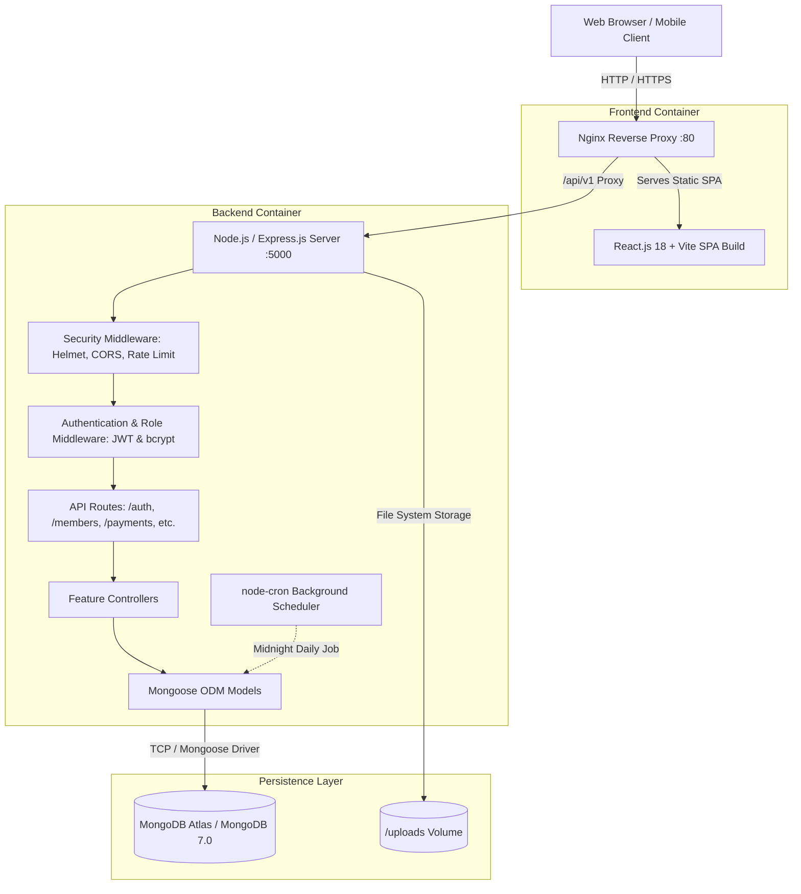

# FitTrack Pro – System Architecture & Technical Specification

## 1. Architectural Overview

FitTrack Pro is architected as a modular, decoupled, single-gym management web platform engineered to satisfy both enterprise software engineering standards and university Problem-Based Learning (PBL) criteria.

The application follows a strict tiered flow:
```
React Frontend (Vite + Tailwind CSS + Recharts)
   ↓  [REST / JSON over HTTPS via Axios]
Nginx Reverse Proxy & Static Asset Server
   ↓  [Forwarded Headers / Load Balanced]
Express.js REST API Backend (/api/v1)
   ↓  [Helmet, Rate Limiter, CORS, JWT Auth & RBAC Middleware]
Controllers (Request handling & Response formatting)
   ↓
Domain Services & Business Validation Rules
   ↓
Mongoose ODM Data Layer & Validation
   ↓
MongoDB Database (Atlas Cloud / Local Dockerized Engine)
```

---

## 2. Mermaid System Architecture Diagram



---

## 3. Frontend Architecture

### 3.1 Technology Foundation
- **Framework**: React 18 with Vite for near-instant Hot Module Replacement (HMR) and optimized rollup production bundling.
- **Styling**: Tailwind CSS configured with a dedicated luxury dark gym palette:
  - Main Background: `#101312`
  - Card / Surface: `#191F1C`
  - Elevated Surface: `#222B27`
  - Borders: `#2C3A33`
  - Primary Emerald Accent: `#10B981`
  - Main Typography: `#F5F7F6`
- **Navigation**: React Router DOM (v6) with declarative role-gated routes (`ProtectedRoute.jsx`).
- **Data Visualization**: Recharts for dynamic financial trends, membership distribution pies, and athlete progress lines.
- **Icons**: Lucide React for modern, consistent iconography.

### 3.2 State & Service Segregation
- `api.js`: Central Axios instance injecting JWT authorization headers and intercepting 401 session expirations.
- `AuthContext.jsx`: Provides centralized authentication state (`user`, `token`, `role`, `mustChangePassword`, `login`, `register`, `logout`).
- Component hierarchy keeps dumb presentational components (`Card`, `Button`, `Modal`, `Badge`) cleanly separated from smart stateful feature views.

---

## 4. Backend Architecture

### 4.1 REST API Design Standards
The API adheres strictly to REST principles with unified response payloads:
```json
{
  "success": true,
  "message": "Operation completed successfully.",
  "data": { ... }
}
```
In error states:
```json
{
  "success": false,
  "message": "Descriptive human-readable error explanation.",
  "errors": [ ... ]
}
```

### 4.2 Security & Access Control
1. **Password Encryption**: All credentials are encrypted using `bcryptjs` with 10 salt rounds before storage.
2. **Stateless JWT Authorization**: Tokens signed with high-entropy cryptographic secrets with configurable TTL (`7d`).
3. **Role-Based Access Control (RBAC)**: Middleware strictly checks user roles (`admin`, `trainer`, `member`).
4. **Ownership Verification**:
   - Members can strictly query their own membership, payment history, attendance, and fitness metrics.
   - Trainers can strictly view assigned athletes and their own salary statements.
   - Public trainer self-registration is physically blocked; only authenticated admins can provision trainer profiles.

---

## 5. Background Scheduled Automation

The platform incorporates `node-cron` running an automated maintenance daemon:
- **Daily Midnight Cron (`0 0 * * *`)**:
  - Automatically identifies memberships reaching their expiration date and transitions status from `active` to `expired`.
  - Dispatches automated in-app alerts at **7 days**, **3 days**, **1 day**, and **day of expiry**.
  - Employs a composite deduplication key (`dedupKey = "expiry-${days}d-${id}-${date}"`) to prevent duplicate notification spam.

