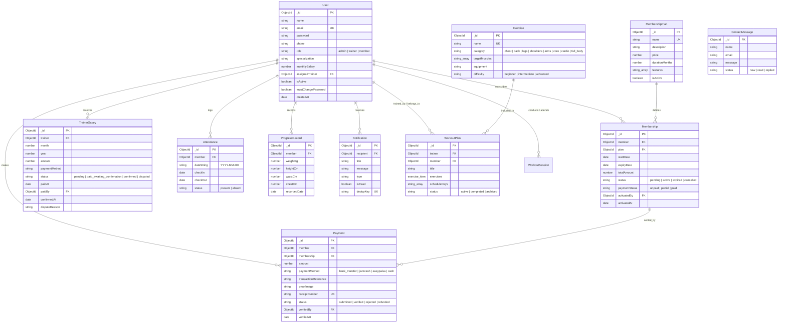

# FitTrack Pro – Database Design & Schema Specification

## 1. Database Architecture Overview

FitTrack Pro utilizes **MongoDB** with the **Mongoose ODM**. The schema design balances relational integrity with document document-store flexibility, featuring compound unique constraints, referential indexes, and audit timestamps across all collections.

---

## 2. Mermaid Entity-Relationship (ER) Diagram

---

## 3. Database Indexes & Anti-Tamper Constraints

### 3.1 Composite Unique Constraints
1. **Attendance Deduplication**:
   - Index: `{ member: 1, dateString: 1 }` with `{ unique: true }`
   - Purpose: Strictly prevents multiple turnstile check-ins for the same athlete on the same calendar day.
2. **Trainer Salary Idempotence**:
   - Index: `{ trainer: 1, month: 1, year: 1 }` with `{ unique: true }`
   - Purpose: Physically enforces that only one monthly salary record can be created for any trainer per month/year.
3. **Notification Deduplication**:
   - Index: `{ dedupKey: 1 }` with `{ unique: true, sparse: true }`
   - Purpose: Eliminates duplicate scheduled expiry reminders.
4. **Receipt Number Uniqueness**:
   - Index: `{ receiptNumber: 1 }` with `{ unique: true, sparse: true }`
   - Purpose: Guarantees every verified payment receipt is globally distinct.
